<h1>Welcome, I'm Hung (Charles)</h1>

<strong>Researcher @ <a href="https://cair.vinuni.edu.vn/">Center for AI Research (CAIR), VinUniversity</a></strong> · <strong>Data Science &amp; AI @ HCMUT</strong> Ho Chi Minh City, Vietnam · Expected graduation: 2028

<em>From GNSS-denied skies to decision-grade data — I engineer AI where certainty is scarce.</em>

---

## Contributions

<picture>
  <source media="(prefers-color-scheme: dark)" srcset="assets/contributions-dark.svg" />
  <source media="(prefers-color-scheme: light)" srcset="assets/contributions.svg" />
  
</picture>

## GitHub streak

## Technical stack

| Category | Technologies |
| :--- | :--- |
| 💻 **Languages** |    |
| 🧠 **AI & vision** |     |
| 📊 **Data & analytics** |     |
| ⚙️ **Backend & delivery** |     |
| 🛠️ **Engineering tools** |    |

## Experience

### Researcher · [Center for AI Research (CAIR), VinUniversity](https://cair.vinuni.edu.vn/)

**Current role**

Researcher at CAIR, the AI research center of VinUniversity, whose research spans generative AI, human-centric systems, and biomorphic intelligence.

### AI Engineer Intern · [THG Fulfill — Transport Happiness Group](https://thgfulfill.com/vi)

**Sep 2026 – Nov 2026** · Cross-border e-commerce fulfillment

Applied AI engineering to a business connecting product sourcing, print-on-demand, dropshipping, shipping, and U.S. warehousing across Vietnam, China, and the United States. Focused on practical uses of AI for data-rich logistics and seller operations.

## Research & Selected Projects

<h3>POLARIS — GNSS-Denied UAV Localization 
Submitting: Defence Technology (rank Q1)</h3>

*Research manuscript · Code remains private.*

**Research team lead & algorithm lead** · 7-person team · Jan 2025–present

Leading a computer-vision pipeline for UAV localization in GNSS-denied environments. On a **60-frame benchmark across three sites**, compared with the CFBVM baseline:

| Measure | CFBVM baseline | POLARIS |
| :--- | ---: | ---: |
| Mean runtime | 107.88 s | **39.07 s** (−63.8%) |
| Pose availability | 50 / 60 | **60 / 60** |
| Mean positional error | 0.2473 m | **0.0110 m** |

<h3><a href="https://github.com/hanestuamante/Gladiators">Gladiators — Verifiable AI Analytics</a> 
1st Place · AREA 303 AI for E-Commerce Hackathon 2026</h3>

**Team Lead · Solution & System Architect** · Sep 2026

Built a natural-language analytics system that checks its answers against business rules. It covered **102 business concepts** and **440 expressions in 3 languages**. In our team's evaluation against a conventional LLM-to-SQL baseline: **nearly 3× answer accuracy**, **over 160× faster execution**, and confidently incorrect answers fell **65.9% → 0%**.

`Python` `FastAPI` `DuckDB` `SQLGlot` `Pandas` `LLM APIs` `Docker`

<h3><a href="https://github.com/hungkhuu404/OpenAIxSea-On_the_mic">Grounded Claim Ledger — Adaptive AI for Livestream Compliance</a> 
Top 40/400 · Sea × OpenAI Regional Codex Hackathon — Vietnam 2026</h3>

**Team Lead** · 4-person team · Oct 2026

Led the development of evidence-grounded verification for Vietnamese livestream commerce, combining **LLM claim extraction, dual-prompt assessment and deterministic rules**. Owned system contracts and guardrails checking product references, source quotations and effective dates.

Integrated a **feedback-driven adaptive loop** that proposes rules and tests from reviewer corrections, with automated checks and human approval. Supported **rule quarantine, versioned replay and auditable decision history**.

`Python` `FastAPI` `asyncio` `Pydantic` `SQLite` `SSE` `OpenAI Codex` `pytest`

## Education & Awards

**HCMUT OISP Scholarship 2025–2026** · GPA **3.5/4.0** · IELTS **7.0** · MOS Excel **1000/1000**

Interested in **AI research and AI engineering** at the intersection of perception, data, and real-world decisions. [Let's talk by email](mailto:giahung170806@gmail.com).

Build. Measure. Improve. Repeat.

