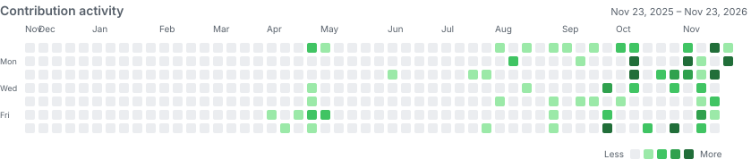

<!-- Header -->

  

  

  
  
  

---

## 👋 About me

I'm Hung (Charles), a third-year **Data Science & AI** student at **Ho Chi Minh City University of Technology (HCMUT), VNU-HCM**, expected to graduate in 2028. I work on AI where certainty is scarce: locating a drone without GNSS, checking whether an agent's code is actually secure, and making analytics answers that can show their evidence.

- 🔬 **Researcher** at the [Center for AI Research (CAIR), VinUniversity](https://cair.vinuni.edu.vn/), working on computer vision and agentic behavior
- 🛰️ Leading **POLARIS**, a 7-person research project on GNSS-denied UAV localization
- 🛡️ **Lead & first author** of a Registered Report **submitted to MSR 2027** (CORE Rank A conference) on security rules and tool feedback in AI coding agents
- 🏆 **1st Place** AREA 303 AI for E-Commerce · **Top 10 Vietnam & Global Nominee representing Vietnam** NASA Space Apps Challenge · **3rd Place** ESG Innovation Challenge · **Top 10** UIT Data Science Challenge · **Top 40/400** Sea × OpenAI Codex Hackathon
- 🎓 HCMUT OISP Scholarship 2025–2026 · IELTS 7.0

---

## 💼 Experience

| Role | Organization | Period |
|:--|:--|:--|
| **Researcher** · part-time, hybrid | [Center for AI Research (CAIR), VinUniversity](https://cair.vinuni.edu.vn/) | Sep 2026 – Present |
| **AI Engineer Intern** | [THG Fulfill — Transport Happiness Group](https://thgfulfill.com/vi) | Sep 2026 – Present |

At CAIR I run literature surveys, build experiments and evaluate models in computer vision and agentic behavior. At THG I apply AI engineering to cross-border e-commerce fulfillment: LLM-assisted content workflows, backend and data work, and support for ERP solution design.

---

## 🔬 Research

<table>
<tr>
<td width="50%" valign="top">

### 🛰️ POLARIS — GNSS-Denied UAV Localization
Submitting: <b>Defence Technology</b> (rank Q1) · Code private

**Research team lead & algorithm lead** · 7-person team · Jan 2025 – Present

Estimates a UAV's pose when GNSS is unavailable by matching segmented building footprints from the drone camera to a reference map, extending the CFBVM baseline.

- Joint shape–topology features for candidate matching
- Voting that tolerates fragmented footprints
- Guided RANSAC on Sim(2) with conditional Procrustes estimation
- Leading algorithm design, validation and a controlled comparison against the baseline

   

</td>
<td width="50%" valign="top">

### 🛡️ From Security Instructions to Secure Code
Submitted: <b>MSR 2027 Registered Reports</b> (Stage 1) · <b>CORE Rank A</b> conference · Code private

**Lead author & first author** · leading a team of 4 student authors, with 2 faculty co-authors · Nov 2026 – Present

*Rules, Executable Feedback, and the Compliance–Security Gap in Coding Agents.* Do security rules in `AGENTS.md`/`CLAUDE.md` and feedback from analysis tools actually make agent code secure, or do agents just comply?

- 2×3 within-task factorial on **SecureVibeBench** (105 C/C++ tasks from real vulnerabilities): **SEI CERT** rules × {no repair, self-review, sanitizer + static-analysis feedback} at equal repair budget
- Two agent configurations, **Claude Code** and **Codex CLI**
- Security judged by a hidden proof-of-vulnerability oracle that must execute the code the agent changed
- Pre-registered mixed-effects analysis plus a taxonomy of compliant-but-insecure fixes

    

</td>
</tr>
</table>

---

## 🏆 Hackathons & competitions

| Result | Event | Project |
|:--|:--|:--|
| 🥇 **1st Place** | AREA 303 AI for E-Commerce Hackathon 2026 | [Gladiators](https://github.com/hanestuamante/Gladiators): verifiable AI analytics (team lead) |
| 🌍 **Top 10 Vietnam · Global Nominee representing Vietnam** | NASA Space Apps Challenge 2026 · *Dancing with the SARs* | [Flood Calendar](https://github.com/hungkhuu404/Dancing_with_The_Paddies): NISAR radar flood calendar for rice land (team lead of 6) |
| 🥉 **3rd Place** | ESG Innovation Challenge 2026 | [VoiceGo](https://github.com/Tan28092006/VoiceGo): voice-first mobility for visually impaired riders (~VND 30M team funding) |
| 🎯 **Top 10** | UIT Data Science Challenge 2026 | LegalGenerator: Vietnamese legal QA under a 4B-parameter budget (invited system paper) |
| 🎯 **Top 40 / 400** | Sea × OpenAI Regional Codex Hackathon — Vietnam 2026 | [Grounded Claim Ledger](https://github.com/hungkhuu404/OpenAIxSea-On_the_mic): livestream claim verification (team lead) |
| 📊 Participant | VinDatathon 2026 | [The 4 Outliers](https://github.com/hungkhuu404/Ecommerece-Time-series-forecasting-): revenue leakage and Revenue/COGS forecasting |

---

## 🚀 Featured projects

<table>
<tr>
<td width="50%" valign="top">

### ⚔️ [Gladiators](https://github.com/hanestuamante/Gladiators)
🏆 AREA 303 AI for E-Commerce · 1st Place · Team lead & system architect

Natural-language business analytics that checks its own answers against business rules before showing a number.

- 9-stage agentic pipeline: routing, entity resolution, gating, verification
- SQLGlot enforces SELECT-only SQL on read-only DuckDB
- Asks back or abstains when evidence is missing
- 102 business concepts, 440 expressions in 3 languages
- vs. the team's LLM-to-SQL baseline: **~3× accuracy**, **>160× faster**, confidently wrong answers **65.9% → 0%**

   

</td>
<td width="50%" valign="top">

### 🎙️ [Grounded Claim Ledger](https://github.com/hungkhuu404/OpenAIxSea-On_the_mic)
🏆 Sea × OpenAI Codex Hackathon · Top 40/400 · Team lead of 4

Evidence-grounded checking of what sellers say on Vietnamese livestreams, against the right product file on the right date.

- LLM claim extraction + dual-prompt assessment + deterministic rules
- Guardrails on product IDs, source quotations and effective dates
- Adaptive loop: reviewer corrections → Codex drafts rules and tests → automated gates → human approval
- Rule quarantine, versioned replay, append-only decision ledger
- **1,406** passing unit tests; **89/89** golden cases replay deterministically

   

</td>
</tr>
<tr>
<td width="50%" valign="top">

### 🌾 [Flood Calendar](https://github.com/hungkhuu404/Dancing_with_The_Paddies)
🌍 NASA Space Apps 2026 · Top 10 Vietnam, Global Nominee representing Vietnam · Team lead of 6 · [live web app](https://floodcalendar.pages.dev)

A flood calendar for every 250 m block of flooded rice land, kept by NASA–ISRO **NISAR** L-band radar, which sees water through cloud.

- Per block: is open water still there, when it arrived, how long it stayed
- 33 real 2026 NISAR acquisitions over two countries (Tân Hội, Vietnam · Bang Rakam, Thailand)
- Tân Hội: open water 1,206 ha → **9,850 ha** (16 Aug → 3 Nov 2026) over 2,344 blocks
- Post-hoc agreement with NASA OPERA DSWx-S1: median Cohen's κ **0.56–0.57**
- JSON Schemas and an offline checker for every published file

   

</td>
<td width="50%" valign="top">

### ⚖️ LegalGenerator
🏆 UIT Data Science Challenge 2026 · Top 10 · Co-author, system design

Vietnamese legal question answering with citations, under a 4B-parameter system limit. Invited to write a system description paper.

- Hybrid retrieval over **8,532** legal documents: citation lookup + BM25 + dense embeddings, fused with RRF
- 568M cross-encoder reranker
- A hand audit of 47 generated answers led the team to switch to an extractive generator (+0.11 METEOR on a held-out fold)
- Final **Private METEOR 0.6209**

   

</td>
</tr>
</table>

<b>📂 More projects</b>

 

| Project | What it is | Stack |
|:--|:--|:--|
| [VoiceGo](https://github.com/Tan28092006/VoiceGo) | Voice-first ride-hailing for visually impaired riders; I worked on route-deviation monitoring and driver–passenger identification. 3rd Place, ESG Innovation Challenge 2026 | — |
| [The 4 Outliers — VinDatathon](https://github.com/hungkhuu404/Ecommerece-Time-series-forecasting-) | E-commerce revenue leakage analysis and 548-day Revenue/COGS forecasting. I built the preprocessing and audit of 14 tables, shared feature tables with leakage checks, and the EDA | Python · Pandas · XGBoost · CatBoost |

---

## 📜 Education & certifications

| | |
|:--|:--|
| 🎓 **HCMUT, VNU-HCM** | B.Sc. Data Science & Artificial Intelligence · Aug 2024 – Aug 2028 (expected) · GPA **3.5/4.0** |
| 🏅 **Scholarship** | HCMUT OISP International Study Programs Scholarship 2025–2026 |
| 🌏 **IELTS Academic** | **7.0** (Reading 8.5 · Listening 7.5) |
| 📊 **Microsoft** | MOS Excel **1000/1000** |

---

## 🛠️ Tech stack

  <b>Languages</b>  
  

  <b>AI & data</b>  
  

  <b>Cloud & tools</b>  
  

**Also:** Transformers · RAG (BM25, dense retrieval, RRF, reranking) · LLM APIs · Claude Code · Codex · DuckDB · SQLGlot · Pandas · NumPy · asyncio · Pydantic · pytest

---

## 🌱 Contributions

  <picture>
    <source media="(prefers-color-scheme: dark)" srcset="assets/contributions-dark.svg" />
    <source media="(prefers-color-scheme: light)" srcset="assets/contributions.svg" />
    
  </picture>

  

  

